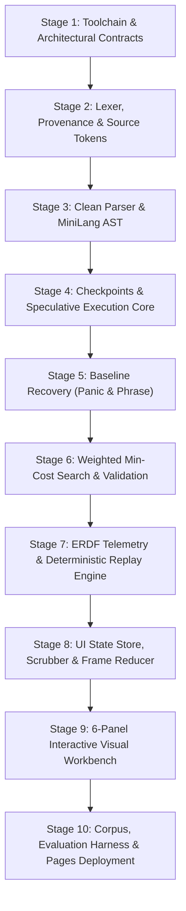

# Implementation Plan: Self-Healing Parser Visualizer v2 (ERDF)

## Executive Overview

This plan outlines the end-to-end engineering roadmap for building **Self-Healing Parser Visualizer v2** and its underlying **Explainable Recovery Decision Framework (ERDF)**.

The project is structured into **10 strictly sequential, verifiable stages**, taking the repository from an empty scaffold to a fully tested, browser-native research and teaching workbench ready for static deployment on GitHub Pages.



---

## Architecture Principles & Guardrails

1. **Pure Core, Derived UI**: The parsing and recovery engine has no DOM or UI dependencies. Parsing is modeled as a pure function:
   $$\operatorname{parse}(T, G, C) \rightarrow (A, D, E)$$
   where $T$ is the immutable token stream, $G$ is the grammar specification, $C$ is the recovery configuration, $A$ is the recovered AST, $D$ is the diagnostic list, and $E$ is the immutable ERDF event log.
2. **Non-Mutating Speculation**: Speculative recovery branches parse virtual token sequences without mutating committed tokens, committed AST nodes, or committed event logs.
3. **Provable Determinism**: Deterministic tie-breaking across candidates and state-hashing at each checkpoint ensure that replaying identical input with the same configuration produces byte-identical traces.
4. **Honest Provenance**: Synthetic tokens and reconstructed AST nodes are permanently labeled as `synthetic` / `recovered` / `ghost` and never disguised as user-authored code.

---

## Detailed 10-Stage Implementation Plan

### Stage 1: Toolchain, Scaffolding & Architecture Contracts

Establish the modern browser runtime toolchain, directory structure, TypeScript configurations, linting, testing harnesses, and foundational interface contracts.

#### 1. Tasks & Implementation Steps
- **Project Scaffolding**:
  - Initialize Vite with React (`@vitejs/plugin-react`) and TypeScript (`strict: true`, `noImplicitAny: true`, `exactOptionalPropertyTypes: true`).
  - Configure Tailwind CSS (or scoped CSS modules) for design system tokens (supporting accessible color-contrast and reduced-motion modes).
  - Setup Vitest with coverage reporter (`v8`) and snapshot testing.
- **Directory Layout Setup**:
  ```text
  src/
  ├── language/       # Tokens, source spans, grammar types, AST contracts
  ├── parser/         # Pratt parser, recursive-descent grammar rules, checkpoints
  ├── recovery/       # Panic, phrase-level, min-cost search, speculative validator
  ├── erdf/           # Event schema, canonical serializer, state hasher, replay reducer
  ├── state/          # Zustand / immutable frame store and playback controller
  ├── ui/             # 6-panel layout: Editor, TokenLane, Inspector, Arena, AST, Timeline
  ├── config/         # Versioned recovery cost profiles and grammar definitions
  ├── demos/          # Curated test programs and expected error scenarios
  ├── corpus/         # Benchmark seeds, mutation engines, and labels
  └── utils/          # Fast hashing (FNV-1a / Murmur3), formatters, assertion helpers
  ```
- **Foundation Types Definition**:
  - Define core configuration interfaces (`RecoveryConfig`, `CostWeights`, `PruningBudgets`).
  - Define error and diagnostic interfaces (`Diagnostic`, `DiagnosticSeverity`, `SourceSpan`).

#### 2. Deliverables
- `package.json`, `tsconfig.json`, `vite.config.ts`, `vitest.config.ts`.
- `src/language/types.ts` & `src/config/defaultConfig.ts`.
- Passing smoke test verifying Vitest test runner.

#### 3. Exit Criteria
- `npm run build` succeeds cleanly with zero type errors.
- `npm run test` executes and passes initial environmental assertions.

---

### Stage 2: Lexer, Provenance & Source Tokens

Implement a robust, location-aware lexer for MiniLang that tracks absolute character offsets, 1-based line/column numbers, and token origins.

#### 1. Tasks & Implementation Steps
- **Token Model**:
  ```ts
  export type TokenOrigin = 'source' | 'synthetic';

  export interface SourceSpan {
    readonly start: number; // 0-based character offset
    readonly end: number;   // exclusive
    readonly line: number;  // 1-based line
    readonly column: number;// 1-based column
  }

  export interface Token {
    readonly id: string;           // deterministic: `tok-${index}-${start}-${end}`
    readonly kind: TokenKind;
    readonly lexeme: string;
    readonly span: SourceSpan;
    readonly origin: TokenOrigin;
    readonly syntheticReason?: string;
  }
  ```
- **Lexer State Machine**:
  - Implement zero-dependency lexer recognizing:
    - Keywords: `let`, `if`, `else`, `while`.
    - Literals: Integer and floating numbers (`NUMBER`), double-quoted strings with escapes (`STRING`), identifiers (`IDENT`).
    - Operators & Delimiters: `+`, `-`, `*`, `/`, `=`, `==`, `!=`, `<`, `>`, `<=`, `>=`, `!`, `&&`, `||`, `(`, `)`, `{`, `}`, `,`, `;`.
    - Whitespace & Comments: Single-line `// ...` and block `/* ... */` discarded into a trivia list or recorded for source fidelity.
    - Sentinel: Terminal `EOF` token with span at file length.
  - Lexical error handling: Emit `LexicalError` diagnostics for unterminated strings or invalid characters without halting the lexer.

#### 2. Deliverables
- `src/language/tokenKinds.ts`: Enum / union of all token kinds.
- `src/language/lexer.ts`: `tokenize(source: string): { tokens: Token[]; diagnostics: Diagnostic[] }`.
- `tests/unit/lexer.test.ts`: Golden tests covering valid tokens, escaped strings, whitespace/comment preservation, and lexical error recovery.

#### 3. Exit Criteria
- 100% token coverage against all MiniLang grammar constructs.
- Precise span verification: every token's slice from `source.slice(start, end)` matches `lexeme`.

---

### Stage 3: Clean Parser & MiniLang AST

Construct the baseline recursive-descent parser for statements and Pratt parser for expressions, operating cleanly on valid programs before error recovery is introduced.

#### 1. Tasks & Implementation Steps
- **AST Data Contract**:
  ```ts
  export type AstProvenance = 'source' | 'recovered' | 'partial';

  export interface BaseAstNode {
    readonly id: string;
    readonly kind: AstNodeKind;
    readonly span: SourceSpan;
    readonly provenance: AstProvenance;
    readonly repairIds: readonly string[];
  }
  ```
  Implement node types: `Program`, `LetDeclaration`, `IfStatement`, `WhileStatement`, `BlockStatement`, `ExpressionStatement`, `BinaryExpression`, `UnaryExpression`, `AssignmentExpression`, `CallExpression`, `LiteralNode`, `IdentifierNode`, `GroupExpression`.
- **Pratt Expression Parser**:
  - Precedence table (binding powers from assignment up to primary calls/grouping).
  - Prefix parsers (literals, identifiers, unary `!`/`-`, grouped `(`).
  - Infix parsers (arithmetic `+ - * /`, comparison `== != < > <= >=`, logical `&& ||`, assignment `=`, call `(`).
- **Statement & Program Parser**:
  - Declarations: `let x = expr;`
  - Control flow: `if (expr) stmt [else stmt]`, `while (expr) stmt`, `{ ... }`.
  - Termination: Strict enforcement of `;` where required.

#### 2. Deliverables
- `src/language/ast.ts`: Complete AST definitions and factory functions.
- `src/parser/parser.ts`: `parseClean(tokens: Token[]): { ast: Program; diagnostics: Diagnostic[] }`.
- `src/parser/pratt.ts`: Precedence table and Pratt expression handler.
- `tests/unit/cleanParser.test.ts`: Golden AST tests for every language construct, nested expressions, and operator precedence order.

#### 3. Exit Criteria
- Clean parser produces mathematically correct precedence trees for complex expressions (e.g. `1 + 2 * 3 == 7 && !x = y`).
- Zero synthetic nodes or recovery diagnostics generated on valid test suites.

---

### Stage 4: Checkpoints & Speculative Execution Core

Implement lightweight parser checkpoints and a virtual token stream interface allowing speculative trial parses without modifying real parser state.

#### 1. Tasks & Implementation Steps
- **Checkpoint Data Model**:
  ```ts
  export interface CallFrame {
    readonly rule: string;
    readonly phase: string;
  }

  export interface ParserCheckpoint {
    readonly cursor: number;
    readonly callFrames: readonly CallFrame[];
    readonly delimiterStack: readonly TokenKind[];
    readonly diagnosticCount: number;
    readonly stateHash: string;
  }
  ```
- **Virtual Token Stream**:
  - A patched view overlaying an immutable base token array:
    ```ts
    export interface VirtualTokenStream {
      peek(offset?: number): Token;
      consume(): Token;
      cursor(): number;
      applyPatch(edits: readonly Edit[]): VirtualTokenStream;
    }
    ```
- **Speculative Parsing Sandbox**:
  - Speculative runner that instantiates a clone of the parser at `ParserCheckpoint`, swaps the active token stream with a candidate-patched `VirtualTokenStream`, parses ahead up to a bounded window $W$, and returns execution metrics (consumed source tokens, new syntax failures, construct closure status).

#### 2. Deliverables
- `src/parser/checkpoint.ts`: Checkpoint capture, serialization, and validation.
- `src/parser/virtualStream.ts`: Virtual token stream with patch application (insert, delete, replace).
- `src/parser/speculativeRunner.ts`: `runSpeculativeParse(checkpoint, candidate, windowSize): SpeculativeResult`.
- `tests/unit/checkpoint.test.ts`: State capture integrity and speculative sandboxing isolation tests.

#### 3. Exit Criteria
- Speculative parsing operations never alter original tokens, committed AST, or diagnostic counters.
- Checkpoints accurately restore cursor position, delimiter balance, and call stack depth.

---

### Stage 5: Baseline Recovery Strategies (Panic Mode & Phrase-Level)

Equip the parser with initial, robust baseline recovery mechanisms when an `expect(tokenKind)` mismatch is encountered.

#### 1. Tasks & Implementation Steps
- **Synchronization Sets (Panic Mode)**:
  - Define sync tokens per grammar construct:
    - Statements: `;`, `}`, `let`, `if`, `while`, `EOF`.
    - Expressions / Parentheses: `)`, `]`, `,`, `;`.
  - Implement `panicRecover(syncSet)`:
    - Discards tokens until reaching a token in `syncSet`.
    - Creates a `partial` AST node wrapping whatever valid structure was parsed prior to the error.
    - Records discarded token spans to prevent silent data loss.
- **Phrase-Level Repair (Local Synthetic Delimiters)**:
  - Implement heuristic rules for high-frequency omissions:
    - Missing `)` before `{`, `;`, or `let`/`if`.
    - Missing `;` at end of declaration before next keyword or `}`.
    - Missing `}` before `EOF` or next top-level statement.
  - Synthesize virtual `ghost` tokens with `origin: 'synthetic'`, explicit `syntheticReason`, and zero-width/interpolated source span.
- **Termination Invariants**:
  - Add strict progress assertions: recovery must either advance the token cursor or synthesize a consumed token, guaranteeing zero infinite recovery loops.

#### 2. Deliverables
- `src/recovery/panic.ts`: Panic-mode recovery algorithm.
- `src/recovery/phrase.ts`: Phrase-level synthetic insertion generator.
- `src/recovery/syncSets.ts`: Standard sync sets for MiniLang.
- `tests/unit/baselineRecovery.test.ts`: Test missing `;`, unclosed `(`, unclosed `{`, and panic recovery cases.

#### 3. Exit Criteria
- Parser never hangs or throws unhandled exceptions on malformed programs.
- All discarded tokens and synthetic tokens are surfaced in diagnostic messages.

---

### Stage 6: Weighted Minimum-Cost Search & Validation

Implement the core algorithmic contribution: a multi-factor cost model and best-first search engine that explores and validates candidate repairs.

#### 1. Tasks & Implementation Steps
- **Cost Formulation**:
  $$C(E) = \sum_{e \in E} c_{\text{lex}}(e) + \lambda_s P_{\text{struct}}(E) + \lambda_m P_{\text{semantic}}(E) + \lambda_d P_{\text{diagnostic}}(E)$$
  - $c_{\text{lex}}$: Configurable base cost per edit type (insert `;` = 1, insert `)` = 1.5, delete identifier = 5).
  - $P_{\text{struct}}$: Heavy penalty for deleting or inserting block boundaries (`{`, `}`) or across statement boundaries.
  - $P_{\text{semantic}}$: Risk proxy penalizing modifications to variable names, literals, or expressions compared to punctuation.
  - $P_{\text{diagnostic}}$: Penalty for edits that trigger immediate secondary syntax failures during lookahead.
- **Candidate Generation & Search**:
  - Generate 1-edit candidates:
    1. Insert each expected token allowed at current grammar checkpoint.
    2. Delete the offending actual token (if not `EOF`).
    3. Substitute actual token with allowed expected tokens.
  - Bound search using a priority queue (best-first by current cost).
  - Only explore 2-edit combinations if no 1-edit candidate achieves lookahead validation.
  - Pruning conditions: candidates exceeding `maxCost`, violating delimiter nesting thresholds, or exceeding candidate budget.
- **Lookahead Validation Window**:
  - Test candidate in `VirtualTokenStream` across $W$ source-token steps (default $W = 4$).
  - Calculate validation outcome: `pass` (reached $W$ tokens or construct closed), `fail` (hit hard syntax error), `limit` (budget exhausted).
- **Ambiguity & Confidence Heuristic**:
  $$\text{confidence} = \operatorname{clamp}\left(1 - \frac{C_1}{C_{\max}}\right) \times \text{stability} \times \operatorname{margin}(C_2 - C_1)$$
  Flag `ambiguous: true` when top candidates have cost difference $\le \epsilon$.

#### 2. Deliverables
- `src/recovery/costModel.ts`: Cost calculation functions and penalty weights.
- `src/recovery/minCostSearch.ts`: Candidate generator and best-first search queue.
- `src/recovery/validator.ts`: Speculative lookahead validator.
- `src/recovery/confidence.ts`: Confidence and ambiguity calculations.
- `tests/unit/minCostSearch.test.ts`: Validation tests on ambiguous syntax, cost calculation verifications, and pruning bounds.

#### 3. Exit Criteria
- Search explores fewer than the configured budget ceiling (e.g. max 50 states) within $<15\text{ms}$.
- Deterministic tie-breaking ensures identical candidate ranking on every run.

---

### Stage 7: ERDF Telemetry & Deterministic Replay Engine

Formalize the ERDF event specification (`erdf-1`), build the canonical JSON serializer and state hasher, and construct the deterministic replay verifier.

#### 1. Tasks & Implementation Steps
- **ERDF Event Schema**:
  ```ts
  export interface ErdfEvent {
    readonly eventId: number;
    readonly runId: string;
    readonly schemaVersion: 'erdf-1';
    readonly sequence: number;
    readonly phase: 'lex' | 'parse' | 'recovery' | 'commit';
    readonly type: string;
    readonly checkpointRef: string;
    readonly payload: Record<string, unknown>;
    readonly stateHash: string;
  }
  ```
  Implement concrete events:
  - `TokenConsumed`, `NodeCreated`, `SyntaxErrorDetected`
  - `CandidateGenerated`, `CandidatePruned`, `CandidateValidated`, `CandidateRejected`
  - `RepairSelected`, `RepairCommitted`, `PanicDiscard`, `AstPatched`, `RunCompleted`
- **Canonical Serialization & Hash Verification**:
  - Implement deterministic object stringification (sorted keys, fixed decimal formatting).
  - Calculate `stateHash` at each step combining cursor, token states, open nodes, and diagnostic count.
- **Trace Verifier & Replay Reducer**:
  - Reducer function: `reduce(state: ReplayState, event: ErdfEvent): ReplayState`.
  - Offline/CI verifier: Replays the generated event stream from scratch and asserts that the final computed AST hash and diagnostic hash match `RunCompleted`.

#### 2. Deliverables
- `src/erdf/schema.ts`: TypeScript schemas and runtime validation guards.
- `src/erdf/hasher.ts`: Fast canonical serializer and hash calculator.
- `src/erdf/reducer.ts`: Pure event reducer for state reconstruction.
- `src/erdf/verifier.ts`: Verification function `verifyTrace(events, initialInput)`.
- `tests/unit/erdfReplay.test.ts`: Determinism assertions, re-running identical inputs to verify identical event hashes.

#### 3. Exit Criteria
- Zero discrepancy across 100 consecutive replays of complex malformed programs.
- Traces fully validate against the `erdf-1` schema.

---

### Stage 8: UI State Store, Scrubber & Frame Reducer

Build the client-side state machine and time-travel playback controller using Zustand or an immutable reducer, supporting fast scrubbing and snapshot acceleration.

#### 1. Tasks & Implementation Steps
- **Snapshot Caching (Accelerated Scrubbing)**:
  - Cache intermediate state snapshots every $K$ events (e.g., $K = 25$) to enable instantaneous backward and forward seeking without replaying from sequence 0.
- **Playback Controller Store**:
  - State: `events`, `currentSequence`, `playbackSpeed`, `isPlaying`, `selectedCandidateId` (for counterfactual preview), `activePhaseFilter`.
  - Actions:
    - `stepForward()`, `stepBackward()`
    - `jumpToSequence(seq)`
    - `jumpToPhase('recovery' | 'error')`
    - `setPlaybackSpeed(speed)`
    - `selectCounterfactual(candidateId)`: Temporarily swaps the AST view to show the candidate's partial branch without mutating committed history.
- **Timer / Playback Loop**:
  - `requestAnimationFrame` loop with variable delay based on playback speed (0.5x, 1x, 2x, 5x).

#### 2. Deliverables
- `src/state/replayStore.ts`: Zustand store managing playback, snapshots, and event indexing.
- `src/state/playbackController.ts`: Playback timing and phase-jumping utilities.
- `tests/unit/playbackStore.test.ts`: Snapshot cache verification and time-travel jump assertions.

#### 3. Exit Criteria
- Replay state at sequence $N$ reconstructed via snapshot + delta matches full replay from 0.
- Counterfactual previewing is strictly non-destructive.

---

### Stage 9: 6-Panel Interactive Visual Workbench

Assemble the browser interface in React with Monaco Editor, interactive D3/SVG AST visualization, token tape, candidate arena, and decision inspector.

#### 1. Tasks & Implementation Steps

```text
┌────────────────────────────────────────────────────────────────────────┐
│ Top Bar: Demos | Config Preset | Run Hashes | Export Trace | Playback  │
├──────────────────────────┬───────────────────┬─────────────────────────┤
│ 1. Monaco Code Editor    │ 3. Decision       │ 4. Candidate Arena      │
│    (Source + Markers)    │    Inspector      │    (Ranked Cards, Cost  │
│                          │    (Stack & Rule) │     Breakdown, Reasons) │
├──────────────────────────┼───────────────────┴─────────────────────────┤
│ 2. Token Lane            │ 5. AST Canvas (D3 / SVG)                    │
│    (Source / Ghost /     │    (Source Nodes, Dashed Ghost Delimiters,  │
│     Discarded Badges)    │     Partial Incomplete Nodes, Pan/Zoom)     │
├──────────────────────────┴─────────────────────────────────────────────┤
│ 6. Timeline Scrubber (Phase bands, error pips, step & scrub controls)   │
└────────────────────────────────────────────────────────────────────────┘
```

- **Panel 1: Monaco Code Editor**:
  - Syntax highlighting for MiniLang.
  - Inline error squiggles synced to current event's diagnostic span.
  - Dropdown selector for curated demo cases (`unclosed-paren`, `missing-semicolon`, `bad-assignment`, `cascading-blocks`).
- **Panel 2: Token Lane**:
  - Horizontal scrolling ribbon of tokens.
  - Badges distinguishing `source` (solid), `synthetic` (dashed, ghost icon), and `discarded` (struck-through, warning color).
- **Panel 3: Parser Decision Inspector**:
  - Current checkpoint cursor, call stack (`CallFrames`), active rule expectation, actual token vs. sync set.
- **Panel 4: Candidate Arena**:
  - List of generated candidates ordered by rank.
  - Visual badges: `SELECTED` (green), `REJECTED` (gray), `PRUNED` (red).
  - Expandable cost breakdown: Lexical ($c_{\text{lex}}$), Structural ($P_{\text{struct}}$), Semantic ($P_{\text{semantic}}$), Diagnostic ($P_{\text{diag}}$).
  - Speculative validation progress bar ($0 \dots W$).
- **Panel 5: AST Canvas (D3 / SVG)**:
  - Tree layout with pan and zoom controls.
  - Clear visual styling:
    - Normal nodes: solid borders, light backgrounds.
    - Ghost/synthetic nodes: dashed border, purple/ghost tint, repair badge.
    - Partial/panic nodes: orange warning border, incomplete badge.
  - Hovering a node highlights its corresponding source span in Monaco Editor and token lane.
- **Panel 6: Timeline Scrubber**:
  - Interactive slider over total event count.
  - Visual phase track colored by phase (`lex`, `parse`, `recovery`, `commit`).
  - Red pips at error detection moments.
  - Play/pause, step forward/backward, speed multiplier.

#### 2. Deliverables
- `src/ui/components/EditorPanel.tsx`
- `src/ui/components/TokenLanePanel.tsx`
- `src/ui/components/InspectorPanel.tsx`
- `src/ui/components/CandidateArenaPanel.tsx`
- `src/ui/components/AstCanvasPanel.tsx`
- `src/ui/components/TimelinePanel.tsx`
- `src/ui/App.tsx`: Responsive layout and keyboard shortcut handlers (`Space`, `ArrowLeft`, `ArrowRight`).

#### 3. Exit Criteria
- Responsive, lag-free UI rendering at 60 FPS during time-travel scrubbing.
- Passing accessibility tests: high contrast ratios, non-color-exclusive indicators, keyboard accessibility.

---

### Stage 10: Benchmark Corpus, Evaluation Harness & Pages Deployment

Construct the reproducible evaluation suite, automated mutation generator, metric export scripts, CI/CD pipelines, and static deployment to GitHub Pages.

#### 1. Tasks & Implementation Steps
- **Benchmark Corpus**:
  - Curate clean seed programs covering all MiniLang grammar features (`corpus/seeds/`).
  - Programmatic mutation engine (`corpus/mutator.ts`):
    - Deletion of semicolons, opening/closing delimiters, operators, and keywords.
    - Substitution of operators and punctuation.
    - Inversion and transposition.
  - Corpus manifest (`corpus/manifest.json`) recording seed source, mutation operator, error offset, and oracle repair where unambiguous.
- **Evaluation Harness & Metrics**:
  - Script (`scripts/runCorpus.ts`) executing recovery strategies:
    1. Panic mode only
    2. Phrase-level only
    3. Weighted minimum-cost only
    4. Combined portfolio (ERDF default)
  - Metrics collected:
    - Recovery success rate (%)
    - Exact oracle repair match rate (%)
    - Weighted edit cost
    - Retained AST node ratio relative to oracle clean parse
    - Diagnostic cascade count
    - Execution time (percentiles: p50, p90, p99)
  - Output raw results to `results/corpus-results.json` and summary markdown table.
- **Static Deployment & CI/CD**:
  - Configure Vite `base` URL for GitHub Pages.
  - GitHub Actions workflow (`.github/workflows/deploy.yml`):
    1. Run type checks (`tsc --noEmit`).
    2. Run Vitest test suite (`vitest run`).
    3. Run trace verifier on benchmark suite.
    4. Build static bundle (`vite build`).
    5. Deploy `dist/` to GitHub Pages.

#### 2. Deliverables
- `corpus/seeds/*.ml`: Seed programs.
- `corpus/mutator.ts` & `scripts/runCorpus.ts`: Mutation and benchmark runner.
- `scripts/verifyTraces.ts`: Deterministic replay test runner for CI.
- `.github/workflows/ci.yml` & `.github/workflows/deploy.yml`.

#### 3. Exit Criteria
- Automated CI pipeline runs tests, validates determinism, builds, and deploys without human intervention.
- Static deployment accessible in-browser with complete offline functionality.

---

## Stage Progress & Verification Matrix

| Stage | Focus Area | Core Technologies | Primary Artifact / Output | Exit Verification Test |
| :---: | :--- | :--- | :--- | :--- |
| **1** | Toolchain & Contracts | Vite, TS, Tailwind, Vitest | `tsconfig.json`, types, directory tree | Build & test runner smoke pass |
| **2** | Lexer & Tokens | TypeScript State Machine | `lexer.ts`, `tokens.ts` | Golden token & span match test |
| **3** | Clean Parser & AST | Recursive Descent + Pratt | `ast.ts`, `parser.ts`, `pratt.ts` | Valid programs parse with 0 errors |
| **4** | Checkpoints & Speculation | Immutable snapshots, Virtual stream | `checkpoint.ts`, `virtualStream.ts` | Non-mutating sandbox isolation test |
| **5** | Baseline Recovery | Sync sets, Phrase synthesis | `panic.ts`, `phrase.ts` | Non-looping recovery on malformed code |
| **6** | Min-Cost Search & Scoring | Best-First Search, Lookahead | `minCostSearch.ts`, `costModel.ts` | Bounded candidate search $<15\text{ms}$ |
| **7** | ERDF Telemetry & Hasher | `erdf-1` schema, Replay reducer | `schema.ts`, `hasher.ts`, `verifier.ts` | 100% trace replay hash identity |
| **8** | State Store & Scrubber | Zustand / Immutable Reducer | `replayStore.ts`, snapshots | Accurate bidirectional time-travel |
| **9** | 6-Panel Visual Workbench | React, Monaco Editor, D3/SVG | Complete UI component suite | Smooth 60 FPS scrubber & AST canvas |
| **10**| Evaluation & Deployment | Corpus mutator, CI, GitHub Pages | `runCorpus.ts`, `.github/workflows/` | Green CI build & live static deployment |
