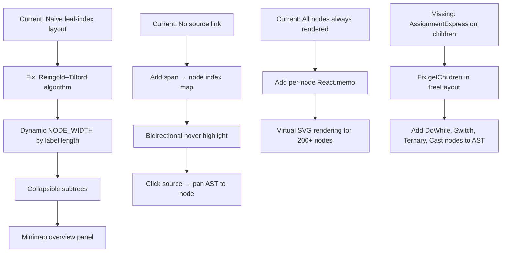

# Self-Healing Parser Visualizer — Full Project Analysis

> Deep audit of every component, engine, state layer, and AST system.

---

## Priority Matrix

| Severity | Count | Category |
|----------|-------|----------|
| 🔴 Critical | 4 | Logic bugs that break correctness |
| 🟠 High | 6 | Major UX / data integrity issues |
| 🟡 Medium | 9 | Noticeable but non-breaking issues |
| 🟢 Low | 8 | Polish & dead code |

---

## 🔴 CRITICAL BUGS

### 1. Duplicate Playback Timers — Double Speed Race Condition
**Files:** `App.tsx` (line 43) AND `TimelinePanel.tsx` (line 28)

Both independently create a `setInterval` tied to `isPlaying`. Both fire simultaneously → the timeline steps at **2× speed** (or more). The timer must live in one place only (`App.tsx`). The `useEffect` playback loop inside `TimelinePanel.tsx` should be removed entirely.

---

### 2. `candidateCounter` Never Reset Between Parser Runs
**File:** `minCostSearch.ts` (line 21)

`candidateCounter` is a module-level `let` that **never resets**. Each new parse accumulates IDs from where the last left off. `resetCandidateCounter()` is exported but **never called** in `replayStore.ts → runParser()`. This breaks deterministic replay — the same source produces different candidate IDs on each run.

**Fix:** Call `resetCandidateCounter()` inside `runParser()` before `parseWithErdf(...)`.

---

### 3. `RepairCommitted` Splice — Index Drift Bug
**File:** `reducer.ts` (lines 201–210)

When multiple edits are applied in sequence using raw `array.splice()`, each splice shifts indices. A delete at position 5 followed by an insert at position 6 now targets the wrong token. `VirtualTokenStream.fromEdits` already handles this correctly with offset tracking — the reducer should too (apply edits in **descending order**).

---

### 4. Unsafe `(this as any).stream` Mutation in Parser
**File:** `recoveringParser.ts` (line 127)

Directly mutates a parent class's private field by casting to `any`. If the `Parser` base class is ever compiled with native ES private fields (`#stream`), this silently breaks. A `protected setStream()` method should be exposed on the base class instead.

---

## 🟠 HIGH PRIORITY

### 5. Counterfactual AST Blocks Main Thread in `useMemo`
**File:** `AstCanvasPanel.tsx` (lines 48–73)

`tokenize()` + `VirtualTokenStream.fromEdits()` + `new RecoveringParser()` + `.parse()` all run **synchronously inside a `useMemo`**. For any non-trivial input this freezes the UI every time `selectedCandidate`, `sourceCode`, or `config` changes. Should be moved to a `useEffect` + local state with a loading indicator.

---

### 6. ERDF Events Are Post-Hoc — Replay Order Is Misleading
**File:** `instrumentedParser.ts` (lines 69–172)

The parser runs to completion first, then events are emitted in loops. Events appear in artificial order: all `TokenConsumed` events first, then all recovery events — even though errors occurred mid-parse. This makes the replay timeline semantically incorrect. A `SyntaxErrorDetected` event appears *after* all token consumption events in the log, even though the error happened mid-parse.

---

### 7. `setConfig` Shallow Merge Destroys Nested Keys
**File:** `replayStore.ts` (line 64)

```ts
{ config: { ...state.config, ...newConfig } }
```
If `newConfig` is `{ weights: { structural: 5.0 } }` (a partial object), the spread **replaces the entire `weights` object** — `semanticRisk` and `diagnostic` keys are silently lost. Needs a deep merge for nested objects.

---

### 8. `AssignmentExpression` Missing from `treeLayout.getChildren`
**File:** `src/ui/utils/treeLayout.ts`

`AssignmentExpression` falls into `default: return []` — it renders as a **leaf node with no children** in the canvas, even though it has `assignee` and `value` child nodes. This makes the AST tree structurally wrong for any assignment operation.

---

### 9. Naive Tree Layout — Node Overlaps on Wide Trees
**File:** `src/ui/utils/treeLayout.ts`

The layout assigns `x = leafIndex × (NODE_WIDTH + SPACING)`. For programs with many sequential statements in a `BlockStatement`, sibling subtrees **visually overlap** because no contour/separation check is performed. A proper **Reingold–Tilford** algorithm is needed.

---

### 10. `TokenConsumed` Events Use Wrong `activeRule` — Always "statement"
**File:** `instrumentedParser.ts` (lines 70–77)

All `TokenConsumed` events are emitted with `activeRule: 'statement'` regardless of actual grammar context. The Inspector panel always shows "statement" during replay even when parsing expressions, parameters, or function bodies.

---

## 🟡 MEDIUM ISSUES

| # | File | Issue |
|---|------|-------|
| 11 | `TopBar.tsx` | Demo `<select>` has no `value` prop — uncontrolled, always shows first option |
| 12 | `TopBar.tsx` | `viewMode` prop & buttons accepted but **never rendered** — dead UI infrastructure |
| 13 | `EditorPanel.tsx` | `warningCount` label displays **"recovered"** instead of "warnings" |
| 14 | `replayStore.ts` | `loadDemo` resets to timeline **end** (`finalSeq`) instead of step 0 |
| 15 | `replayStore.ts` | `jumpToPhase` always jumps to **first** event of a phase, ignores `currentSequence` |
| 16 | `replayStore.ts` | No `try/catch` in `runParser()` — any uncaught exception crashes the store |
| 17 | `CandidateArenaPanel.tsx` | `cand.cost.total` has no `.toFixed(2)` — raw float `3.29999999` renders in UI |
| 18 | `ConfigModal.tsx` | `maxEdits` and `maxExploredStates` exist in config but have **no UI controls** |
| 19 | `ConfigModal.tsx` | `maxCost` input has no `min`/`max` — negative values and `Infinity` silently pass |

---

## 🟢 LOW PRIORITY / POLISH

| # | Location | Issue |
|---|----------|-------|
| 20 | All components | `slate-850`, `slate-750`, `slate-650`, `py-0.2` — **non-existent Tailwind classes** (silent no-op) |
| 21 | `AstCanvasPanel.tsx` | Export PNG resets to `scale(1)` — ignores the user's current zoom/pan view |
| 22 | `AstCanvasPanel.tsx` | SVG `overflow-hidden` clips nodes near canvas edges during pan |
| 23 | `ContextDrawer.tsx` + `CandidateArenaPanel.tsx` | Candidate card UI duplicated — DRY violation, should share a `<CandidateCard>` component |
| 24 | `erdf/schema.ts` | `AstPatchedEvent` defined in schema but **never emitted**, handler in reducer is a no-op |
| 25 | `recovery/phrase.ts` | Phrase recovery strategy is **imported nowhere** — dead code / incomplete feature |
| 26 | `TokenLanePanel.tsx` | No auto-scroll to current token during playback |
| 27 | `EditorPanel.tsx` | `Shift+Tab` unindent not handled — breaks IDE muscle memory |

---

## 🌟 MISSING FEATURES — PRODUCTIVITY & UNIQUENESS

### AST Visualization
| Feature | Impact |
|---------|--------|
| **AST Minimap** | Spatial orientation in large trees (50+ nodes); viewport indicator overlay | 
| **Collapsible subtrees** | Click to collapse/expand node children — reduce visual clutter |
| **Node search / filter by kind** | Type "FunctionDeclaration" to highlight matching nodes |
| **Source ↔ AST bidirectional linking** | Hover source → highlights AST node; hover AST node → highlights source range |
| **Keyboard navigation in tree** | Arrow key traversal, Enter to select |
| **Dynamic node width** | Scale `NODE_WIDTH` to label length — denser trees, fewer wasted pixels |
| **Animated transitions** | Smooth morph between AST states on step (GSAP/Framer Motion) |
| **Collapsed subtree count badge** | Show `(3 children hidden)` on collapsed nodes |
| **Pan momentum / inertia** | Release-drag coasts to a stop — feels native |

### Editor Improvements
| Feature | Impact |
|---------|--------|
| **Syntax highlighting** | Token-colored C (C99/C11) source using the real lexer output |
| **Inline error squiggles** | Red underlines at exact error span positions (from diagnostics) |
| **Cursor position indicator** | `Ln X, Col Y` status bar like a real IDE |
| **Source range hover** | Hover over editor text → tooltip shows which AST node covers it |
| **Character limit warning** | Visual indicator when approaching 100,000 char limit |

### Recovery / Analysis
| Feature | Impact |
|---------|--------|
| **"Jump to Previous Error"** | Currently only Next Error; backward navigation missing |
| **Diff view: Original vs. Repaired** | Side-by-side AST before/after committed repair |
| **Token diff highlighting** | Show inserted/deleted/substituted tokens visually in token lane |
| **Recovery confidence meter** | Visual bar showing `confidence.score` for the winning repair |
| **Ambiguity indicator** | When `confidence.isAmbiguous === true`, surface a visible warning |

### Workflow & Export
| Feature | Impact |
|---------|--------|
| **Export AST as JSON** | Download the full structured AST as a JSON file |
| **Config persistence** | Save/load config weights to localStorage; restore on refresh |
| **Source code persistence** | Remember last edited source on page refresh |
| **Demo description panel** | Show each demo's `description` and `expectedErrorPattern` in UI |
| **Keyboard shortcut help overlay** | Press `?` to display all shortcuts |
| **Error count badge on demo selector** | Preview how many errors each demo produces before loading |
| **Continuous playback speed slider** | Replace fixed 5-option select with a smooth range input |

### Infrastructure
| Feature | Impact |
|---------|--------|
| **Virtual scrolling in Token Lane** | Prevent DOM overload for tokens.length > 200 |
| **Loading indicator during parse** | Visual feedback during `runParser()` for large inputs |
| **Toast/notification on config apply** | Confirm re-parse happened after closing ConfigModal |
| **ESLint + Prettier config** | Currently no linting — only TypeScript compiler as code gate |

---

## AST-Specific Improvement Roadmap



---

> **Most impactful single fix:** Resolve the **duplicate playback timer** (Critical #1) — it's invisible but makes every demo run at incorrect speed and invalidates all timing-sensitive replay demonstrations.

> **Most impactful single feature:** **Source ↔ AST bidirectional linking** — transforms this from a passive visualizer into an interactive debugging tool.
